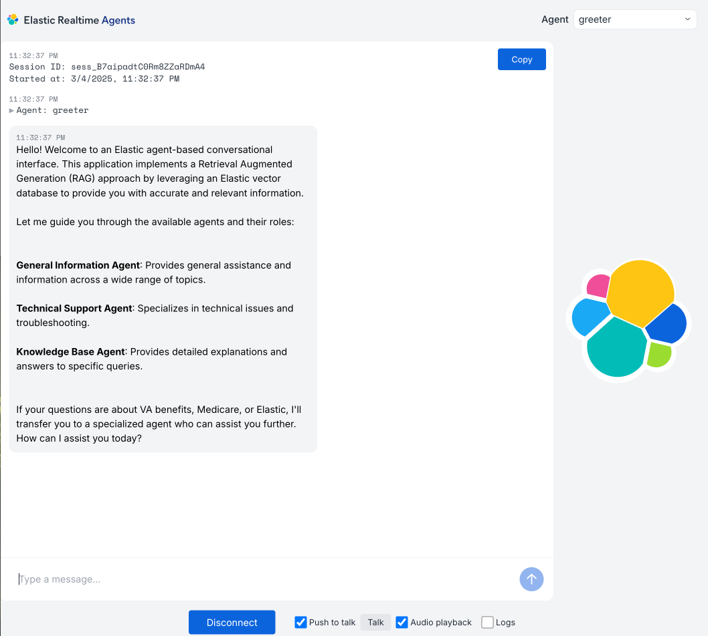

# Realtime API Agents RAG Demo

A Next.js and TypeScript voice application that combines OpenAI Realtime with Elasticsearch retrieval and agent handoffs. Agents answer questions using indexed Elastic Search Labs, VA, Medicare, IRS, and congressional biography content. Agent Builder text chat and observability are optional integrations.



## Local setup

Use Node.js 20.9 or newer and npm. Install the locked dependencies:

```sh
npm ci
```

For a new checkout, copy `.env.example` to `.env.local` and supply credentials. If an environment file already exists, update its existing keys rather than creating conflicting definitions. Never put API keys in `NEXT_PUBLIC_*` variables or commit real environment files.

The voice and retrieval demo requires:

| Variable | Purpose |
| --- | --- |
| `DEMO_PASSWORD_ENABLED` | Optional; protected by default. Set exactly `false` to temporarily disable the password gate |
| `DEMO_PASSWORD` | Random password of at least 16 characters when protection is enabled; login username is `demo` |
| `OPENAI_API_KEY` | Server-side OpenAI key with Realtime access and available quota |
| `OPENAI_REALTIME_MODEL` | Optional; defaults to `gpt-realtime-2.1-mini` |
| `ELASTICSEARCH_CAPSTONE_URL` | Elasticsearch HTTPS endpoint |
| `ELASTICSEARCH_CAPSTONE_API_KEY` | Encoded API key permitted to read the five indices and use their inference services |

```sh
npm run dev
```

Open [http://localhost:3000](http://localhost:3000), sign in with username `demo` and your `DEMO_PASSWORD` if protection is enabled, allow microphone access when prompted. Realtime voice connects automatically once the selected agent is ready. Disconnect stops the session and does not automatically reconnect; select **Connect** to resume. A failed connection waits for an explicit retry. If the browser blocks audio autoplay, select **Enable audio**. The browser must use localhost or HTTPS for microphone access.

Realtime voice requires a working microphone even for typed messages. Denied/unavailable microphone access, or a connection timeout while waiting for the microphone, opens a blocking recovery dialog. Allow access in browser/site and device settings, then use **Refresh and try again** and accept the prompt when the app reconnects. Alternatively, **I've enabled my microphone — reconnect** retries without reloading. Refreshing alone does not clear a saved permission denial. Network failures retain the normal connection error instead of this dialog.

By default, every page and API route is protected by HTTP Basic authentication in `src/proxy.ts`. Missing or short passwords return 503 rather than exposing the app. Set `DEMO_PASSWORD_ENABLED=false` and redeploy to temporarily disable the gate during troubleshooting; no password is required while disabled. Cross-origin API blocking, private/no-store caching headers, and removal of cached Authorization credentials from downstream requests remain active. Remove the flag or set it to `true` and redeploy to restore protection. Keep the password server-side and use HTTPS outside localhost. Browsers remember Basic credentials; use a private browser window and close it after the demo. Rotate `DEMO_PASSWORD` and redeploy to change access. Older deployments keep their original configuration and need separate Vercel protection or removal. This shared password is for controlled demos, not individual user accounts.

The server mints a short-lived token with `/v1/realtime/client_secrets`; the browser exchanges its SDP offer at `/v1/realtime/calls`. The standard OpenAI key stays on the server. Replacing a key alone does not migrate applications using the retired beta session API.

Specialist handoffs retain the Realtime conversation and explicitly pass `user_question` and `conversation_context` in the transfer tool result. The outgoing agent announces an obvious transfer without asking for routing approval. The receiving specialist introduces itself, summarizes the question, and asks for confirmation before retrieving an answer. Its introductory response disables tool calls for that turn only. After confirmation or correction, it searches using the resolved question and context. Generated wording can vary.

## Data sources

These are existing Elasticsearch indices, not live calls to the source websites. The application does not crawl or populate them during setup. It queries the public `semantic_text` interface and returns retrieved passages and available source URLs.

| Agent | Application route | Index | Semantic field |
| --- | --- | --- | --- |
| Elastic | `/api/elasticsearch` | `search-labs-blogs` | `body_semantic` |
| VA | `/api/va` | `search-va` | `semantic_text` |
| Medicare | `/api/medicare` | `search-medicare` | `semantic_text` |
| IRS | `/api/irs` | `search-irs` | `semantic_text` |
| BioGuide | `/api/bioguide` | `person` | `profileText_semantic` |

VA, IRS, and BioGuide combine lexical and semantic retrieval using reciprocal rank fusion. The other routes use semantic retrieval. The indices must contain the expected fields, and their mapped inference endpoints must have healthy model allocations. Green index health does not establish inference readiness.

First retrieval verification after starting the app:

```sh
curl --user demo --fail-with-body 'http://localhost:3000/api/elasticsearch?q=What%20is%20semantic%20search%3F'
```

Enter the demo password at curl's prompt. When `DEMO_PASSWORD_ENABLED=false`, omit `--user demo` to skip that prompt. A successful response contains a `results` array. Review the returned passages and sources as well as the HTTP status.

## Optional Agent Builder and observability

**Agent Builder text mode** requires `KIBANA_URL` and an explicit `KIBANA_API_KEY` with access to the selected space and Agent Builder. Alternatively, set `KIBANA_USERNAME` and `KIBANA_PASSWORD`. Search and event-ingestion keys are never reused as Kibana credentials. If omitted, the Kibana URL can be derived from an Elasticsearch hostname containing `.es.`.

- `AGENT_BUILDER_AGENT_ID` defaults to `elastic-ai-agent`.
- `AGENT_BUILDER_AGENT_MAP_JSON` optionally maps Realtime agent names to Agent Builder agent IDs.
- `KIBANA_SPACE_ID` selects a non-default space.
- Agent Builder model selection is controlled by Kibana and its inference configuration.

**Voice mirroring** is disabled by default. Set `NEXT_PUBLIC_AGENT_BUILDER_MIRROR_ENABLED=true` to send voice/text turns to Agent Builder in addition to OpenAI. This performs additional processing; it is not passive logging. Rebuild after changing this public setting.

**Persisted Agent Builder events** additionally require `ELASTICSEARCH_LOGSAI_API_KEY` with append/create-document permission on the pre-created event index. `AGENT_BUILDER_INDEX_NAME` defaults to `agent-builder-chat-events-v1`. It uses `ELASTICSEARCH_CAPSTONE_URL`.

**Full transcript capture** is disabled by default. Set `TELEMETRY_CAPTURE_FULL_CONTENT=true` only when you intend telemetry and persisted events to include conversation content. Credential redaction still applies.

**FullStory** is disabled by default and requires both `NEXT_PUBLIC_ENABLE_FULLSTORY=true` and `NEXT_PUBLIC_FULLSTORY_ORG_ID`. Rebuild after changing these public settings.

**OpenTelemetry** initializes in production. For local development, enable it with `ENABLE_OTEL=true`. Configure `OTEL_EXPORTER_OTLP_ENDPOINT`, `OTEL_EXPORTER_OTLP_HEADERS`, and `OTEL_SERVICE_NAME` for your collector; the exporters use HTTP/protobuf. Optional browser RUM configuration uses `NEXT_PUBLIC_ELASTIC_APM_SERVER_URL`, `NEXT_PUBLIC_ELASTIC_APM_SERVICE_NAME`, and optional environment/version values. Client transport can be selected with `NEXT_PUBLIC_TELEMETRY_TRANSPORT=server|rum|both`; `NEXT_PUBLIC_TELEMETRY_MIRROR_TO_RUM=false` avoids duplicate RUM mirroring.

The optional email action requires a server-side `ZAP_URL` webhook. Leave it unset when email delivery is not part of your demo.

## Validation and demo rehearsal

```sh
npm run lint
node --test tests/*.test.cjs
npm run build
npm start
```

Tests exercise API validation, retrieval behavior, event handling, handoffs, telemetry safety, and connection cleanup with mocked external services. They do not establish live credentials, deployed model health, or microphone/audio behavior.

Verify a running local server or deployment with the repeatable API smoke check:

```sh
node --env-file=.env.local scripts/check-demo.mjs https://your-preview-deployment.vercel.app
```

This checks the homepage, creates one short-lived Realtime token without printing it, and verifies nonempty results from all five Elasticsearch search routes. It exits nonzero on any failure and sends no email. Microphone capture, audio playback, interruption, and agent handoffs still require the browser rehearsal below.

Before recording:

1. Open the app, select **Connect**, and confirm the status becomes **Connected** and the greeting appears and plays.
2. Ask an Elastic question. Confirm retrieval returns relevant source material and a spoken answer.
3. Type a follow-up and confirm the transcript and audio complete.
4. Ask to switch to VA or another agent, then ask a relevant question. Check the answer and source links.
5. Interrupt an answer; exercise push-to-talk and audio playback controls.
6. Disconnect and reconnect. Confirm microphone capture stops after disconnect and no repeated automatic retries occur on errors.
7. Test Agent Builder text mode separately if it is part of the recording.

The conversation transcript includes messages and expandable tool details. The agent selector changes the active agent; the event panel helps diagnose requests and responses. Keep diagnostic panels closed for the recording when they are not needed.

## Vercel deployment

Set the required environment variables on the intended Vercel project and environment. Preview and Production settings are separate. `NEXT_PUBLIC_*` settings are included at build time, so updating them requires a new deployment.

Build and test a preview before promoting it. Verify the project, deployment URL, Git commit, domain alias, and runtime behavior; Vercel **Ready** means the deployment built, not that OpenAI or Elasticsearch requests work. This README describes configuration and validation, not the current deployment or cluster-upgrade status.

## Extending the agents

Agent prompts, tool schemas, and tool implementations live in [`src/app/agentConfigs`](src/app/agentConfigs). Start with [`elasticBlogsAgent.ts`](src/app/agentConfigs/semanticSearch/elasticBlogsAgent.ts). Retrieval routes live under `src/app/api`; the shared search implementation is [`utility.ts`](src/app/api/utility.ts).

The main flow is browser → OpenAI Realtime → tool call → Next.js retrieval route → Elasticsearch → spoken response. Agent Builder and telemetry run as separate integrations.

## Core contributors

- Noah MacCallum — [noahmacca](https://x.com/noahmacca)
- Ilan Bigio — [ibigio](https://github.com/ibigio)
- Matt Carl — application adaptations and Elastic integrations

The responsive conversation shell fills the available viewport height. Conversation and diagnostics scroll independently; the message composer and connection controls remain visible. Logs use a side panel on wide screens and a dedicated view on narrow screens (toggle Logs off to return). Input autofocus is disabled so a phone keyboard only opens when requested.
