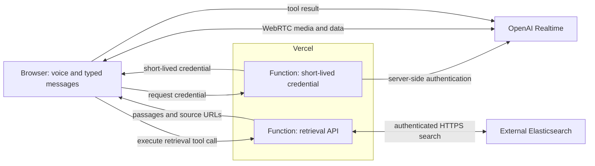
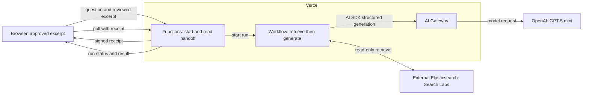

# FedFlow architecture

FedFlow connects a Next.js support interface on Vercel to an existing Elasticsearch knowledge base. Voice and typed conversation use OpenAI Realtime. A separate, reviewer-approved handoff uses Vercel AI SDK, AI Gateway, and Workflows.

## Conversation and retrieval

The standard OpenAI and Elasticsearch API keys remain server-side. The browser uses a short-lived OpenAI credential. Typed messages share the Realtime connection and currently require the same microphone permission as voice. The browser executes retrieval tool calls through the server; OpenAI does not connect directly to Elasticsearch.

The assessment uses the existing `search-labs-blogs` index and its `body_semantic` field. The other specialist routes read their configured indices on the same external service. The app does not crawl source sites, populate indices, or replace Elasticsearch ingestion and relevance management.

## Durable support handoff

The Workflow checkpoints the retrieval and generation steps and owns their bounded retry budget. The approved excerpt, retrieved evidence, and draft are part of the run data. A signed, expiring receipt stored in the browser tab lets it read the same run after a refresh. The recovered handoff is separate from the live audio session, which ends on reload.

The server accepts only citation IDs from the retrieved evidence and returns their validated Elastic URLs. It rejects malformed drafts and can return insufficient evidence. A human must still verify that the recommendation is supported. The sample call uses synthetic text with the same live retrieval and generation path.

## Vercel responsibilities

| Feature | Responsibility |
| --- | --- |
| AI SDK | Structured generation and usage metadata for the handoff |
| AI Gateway | Model routing for the handoff's `openai/gpt-5-mini` call |
| Workflows | Persistent handoff run and step execution |
| Vercel Functions | Next.js credential, retrieval, and handoff API routes |
| Preview Deployments | Commit-specific verification before promotion |
| Vercel Board — development only | Private task coordination and review evidence for coding agents |

OpenAI Realtime media and conversation inference are outside the Gateway handoff path. Elasticsearch remains the knowledge source. Board belongs to the development process and does not hold runtime support conversations.

## Access, failures, and validation

- HTTP Basic authentication protects the demo; the handoff API always requires the demo login. The Workflow queue callback uses the SDK's own authentication.
- User-facing API responses are private and uncached. Deployment readiness does not prove upstream model, credential, or retrieval health.
- A failed browser poll can resume the existing run using its receipt. A failed initial submission can require a new request; submission retries are not an exactly-once guarantee.
- Source content can be stale or insufficient. Retrieval failures and generation failures have separate bounded retries and sanitized errors.
- The demo uses public or synthetic data. A production pilot needs individual identity, run authorization, explicit retention and residency decisions, and usage controls.

For the reviewer script, pilot measures, and rollout plan, see [assessment notes](docs/assessment.md). For setup and exact verification commands, see [README](README.md).
