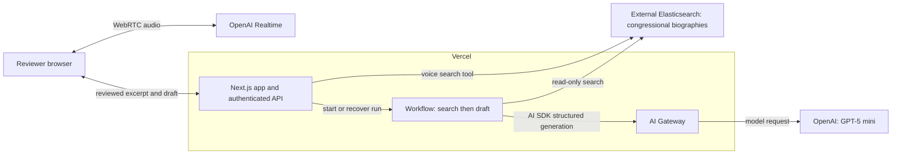

# FedFlow — a cited handoff after a congressional research call

A public affairs research desk fields questions about congressional service. An analyst takes the call, looks up the member in the Biographical Directory of the United States Congress, and writes a sourced handoff for a colleague. Repeating those steps slows down the briefing and leaves the next analyst to check the same dates.

## Architecture

Vercel connects the research workflow to an existing knowledge platform. Elasticsearch retains the index, ingestion, relevance configuration, and search permissions. The demo reads `person` through `profileText_semantic` over authenticated HTTPS. Voice and typed conversation use a short-lived browser credential and a direct OpenAI Realtime connection. Vercel receives the explicitly approved text excerpt for the handoff. These are separate failure paths.

| Vercel choice | Role and trade-off |
| --- | --- |
| AI SDK | Validates the structured draft and gives the app usage data. The server resolves citation IDs against retrieved sources; human review checks whether the recommendation is supported. |
| AI Gateway | Routes the draft call to `openai/gpt-5-mini` and exposes model usage. Its costs cover the draft model call; OpenAI Realtime is billed separately. |
| Workflows | Checkpoints retrieval and generation so the draft can continue when a tab reloads. It introduces state retention and retry semantics that matter in production. |
| Vercel Functions | Runs the Next.js API routes for credential issuance, external retrieval, and starting or reading handoff runs. Long-lived audio travels directly between the browser and OpenAI. |
| Preview Deployments | Pin review to a commit and validate both providers and Elastic before promotion. Build readiness alone does not validate upstream credentials. |

Development agents use Vercel Board for task coordination and review evidence. AI SDK, AI Gateway, and Workflows meet the AI-stack requirement.

## Reviewer walkthrough

1. Open the commit-specific preview from the deck and sign in as `demo` with the supplied test password. If the deployment is protected, use the private link shared from Vercel.
2. Select **Connect**, grant microphone access, and ask “What congressional offices did John Quincy Adams hold, and when?” Inspect the retrieved evidence, then select **Draft handoff**. **Try sample call** uses a synthetic excerpt and the same live dependencies without a microphone.
3. Review the excerpt and select **Generate handoff**. Refresh after submitting, then open the recovered draft and follow its citations. The live audio session is separate from the recovered draft.

The public repository is [FedFlow](https://github.com/matthecarl/FedFlow/tree/codex/vercel-sa-demo). Keep the commit, preview URL, and actual run evidence together in the deck. Supply test credentials privately.

## Evaluation and release

- Run `npm run lint`, `node --test tests/*.test.cjs`, and `npm run build`. Exercise valid sources, irrelevant and missing evidence, a fabricated citation, dependency timeout, and an expired or modified receipt. Prefer deterministic failure fixtures over forcing outages in the shared project.
- In preview, record the same receipt recovering the same result after refresh. Capture actual Gateway model usage, per-draft cost, latency, and the observed Workflow stages. Evaluate voice and the sample separately. For a production pilot, time five paired manual and assisted handoffs, aim for 30% less median preparation time, and require zero unsupported citations in the reviewed sample. These are pilot targets.
- Preview → validation → invited research pilot → cutover → rollback. Advance after an operator verifies access, grounded citations, recovery, and dependency health. Use a 5% then 25% canary before full cutover where Rolling Releases is available. Pause promotion on a citation or recovery regression. Roll back to the last eligible production deployment and verify the voice and sample paths.
- Production requires individual SSO, authorized access to run records, credential rotation, explicit transcript retention and data residency review, and usage controls. Demo data must be public or synthetic. Confirm that a provider change meets the same citation and privacy requirements before promoting it.

## Development tooling

Codex agents worked in parallel on the voice UI, Workflow API and evaluation, and a parser benchmark. Vercel Board held private, unsynced task discussions and sanitized results. These are development tools; the deployed application uses the runtime paths described above.

### Historical parser experiment

The Rust/Wasm prototype targeted the retired event-stream parser. It passed parser parity tests and cut warm p95 CPU time by about 61% on the large local fixture. First-use p95 time was 3.07 ms for Wasm and 0.165 ms for TypeScript, so the prototype missed the startup latency gate.
