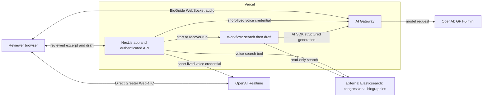

# FedFlow — a cited handoff after a congressional research call

A public affairs research desk fields questions about congressional service. An analyst takes the call, looks up the member in the Biographical Directory of the United States Congress, and writes a sourced handoff for a colleague. Repeating those steps slows down briefings and leaves the next analyst to check the same dates. At an illustrative 20 requests per week and 15 minutes per handoff, preparation takes five analyst-hours a week. The pilot will measure the actual baseline.

## Architecture

Vercel connects the research workflow to the existing Elasticsearch platform, which retains the index, ingestion, relevance configuration, and search permissions. Vercel Functions and Workflow steps in `iad1` send read-only queries to the external Elasticsearch endpoint over HTTPS using a server-side API key. BioGuide reads `person` using `profileText_semantic`, full-text search, and member name fields. The browser receives short-lived voice credentials and sends the reviewed question and transcript excerpt to the Workflow. The Elastic deployment's region and private connectivity are unverified.

For a pilot that requires private network access, validate a Secure Compute connection to the customer network and a private path to Elasticsearch. Verify region, DNS, routing, and index-scoped credentials before using live customer data. [Secure Compute](https://vercel.com/docs/networking/secure-compute)

| Vercel choice | Role and trade-off |
| --- | --- |
| AI SDK | Validates the structured draft and gives the app usage data. The server resolves citation IDs against retrieved sources. A human checks whether each claim follows from the cited record. |
| AI Gateway | Routes specialist conversations to four distinct realtime models and draft generation to `openai/gpt-5-mini`. Gateway usage covers the routed sessions and drafts. |
| Workflows | Checkpoints retrieval and generation so the draft can continue when a tab reloads. It introduces state retention and retry semantics that matter in production. |
| Vercel Functions and Fluid Compute | Runs credential issuance, external retrieval, and Workflow API requests. Project settings confirm Fluid Compute and the `iad1` default region. Concurrency shares instances during I/O waits. Pricing includes active CPU, provisioned memory, and invocations. [Fluid Compute](https://vercel.com/docs/fluid-compute) |
| Preview Deployments | Pin review to a commit and validate both providers and Elastic before promotion. Build readiness alone does not validate upstream credentials. |

The research demo focuses on BioGuide and its cited handoff. The other specialists demonstrate optional provider routing using the same app. Next.js prerenders the page shell. Realtime state is browser-held, and credential, search, and receipt requests fetch live data with `no-store` responses.

## Reviewer walkthrough

1. Open the private Vercel share link and sign in as `demo` with the separately provided test password. A fresh Chromium context accessed the `47c262c` preview through this path without signing into Vercel. The signed link and password are shared privately outside Git. [Vercel shareable links](https://vercel.com/docs/deployment-protection/methods-to-bypass-deployment-protection/sharable-links)
2. Select BioGuide, choose **Connect**, grant microphone access, and ask “What congressional offices did John Quincy Adams hold, and when?” Inspect the retrieved evidence, then select **Draft handoff**. **Try sample call** uses a synthetic excerpt and the same live dependencies without a microphone.
3. Review the excerpt and select **Generate handoff**. Open the draft when it is ready and follow its citations. To demonstrate Workflow recovery, refresh while the draft runs and verify that the same draft returns.

The public assessment source and commit history are on `codex/vercel-sa-demo`. The default `main` branch shows the earlier app. The review package pairs the submitted commit with its deployment URL and the recorded checks. [FedFlow assessment branch](https://github.com/matthecarl/FedFlow/tree/codex/vercel-sa-demo)

## Evaluation and pilot targets

Score each case on the expected status, official citation and claim support, abstention outside the corpus, and recovery of the same run. The 14 focused handoff tests passed using local fixtures with mocked search, generation, and route dependencies. Re-run with `node --test tests/support-handoff.test.cjs tests/support-handoff-ui.test.cjs`.

| Fixture | Passing result |
| --- | --- |
| John Quincy Adams with duplicate hits and an altered indexed URL | Grounded draft with one canonical official member link |
| Missing or irrelevant evidence | Insufficient evidence with no citations |
| Fabricated source ID, unlisted inline `[S#]` citation, bare domain, or Markdown link | Insufficient evidence with no citations |
| Search timeout or provider error | Sanitized failure with bounded retry behavior |
| Tampered or expired receipt, missing run, or temporary outage | Terminal `404` for unavailable runs or invalid receipts, retryable `503` for an outage |
| Lost start response, concurrent retry, or refresh | Same attempt key and draft recover the same Workflow run and receipt. Reusing the key for an edited draft returns `409`. |

Targeted live checks exercised the microphone-free BioGuide sample and recovered the same Workflow draft after refresh, citing official record `A000041`. The `47c262c` preview also completed Greeter → IRS and IRS → VA transfers with synthetic microphone input, including 27.3 seconds of outgoing IRS playback before held speech was processed. The earlier Elastic specialist scored four of five cases on a strict live evaluator. One draft echoed a fabricated citation marker in prose. [BioGuide preview commit](https://github.com/matthecarl/FedFlow/commit/b73b7258969c0eb4e317f1dc86bedf79323789e2) · [Voice preview commit](https://github.com/matthecarl/FedFlow/commit/47c262c0b64b31507c83594106de8ff08115c82e)

Pilot targets are illustrative. Time five paired manual and assisted handoffs and aim for at least **30% less median preparation time** with **zero unsupported citations** in the reviewed sample. In a separate 100-run technical check, target **p95 of 30 seconds or less** from submit to visible draft, **$0.01 or less in Gateway model charges per successful draft**, and **at least 99%** of valid in-flight receipts recovering the same run after refresh. Capture retrieval and generation timings separately. Model charges exclude the voice session and platform costs.

## Release plan

1. Build a commit-specific preview and run lint, `node --test tests/*.test.cjs`, `npm run build`, and the reviewer walkthrough. Verify credential issuance, external search, one-run recovery, citation accuracy, and cost against captured usage before promotion.
2. Start with an invited research pilot. The proposed production canary moves from 5% to 25% once the project’s Rolling Releases configuration is verified. Confirm SSO, least-privilege access to run records, key rotation, data residency and retention, and spending controls before cutover. [Rolling Releases](https://vercel.com/docs/rolling-releases)
3. If the canary emits an unsupported citation or shows a recovery regression, the release owner halts promotion, checks the failed run against the source, and restores the last healthy production deployment with `vercel rollback <deployment-id-or-url>` if needed. Verify sign-in, BioGuide search, and draft recovery on the restored deployment. [Vercel rollback](https://vercel.com/docs/cli/rollback)

## Known limitations and risks

- The preview uses shared credentials and signed receipts. A hosted test on `091a20b` confirmed two concurrent keyed requests and a retry after completion returned the same receipt. Reusing the key with a changed excerpt returned `409`. Older keyless API requests still create separate runs. [Verified commit](https://github.com/matthecarl/FedFlow/commit/091a20bb6b2e34b472243977c3e3edc2e9c14b3d)
- The production dependency audit reports zero critical and three high findings after the compatible patches. The remaining high findings follow the Workflow CLI, its Vercel authentication helper, and that helper's nested Zod dependency.
- If enabled, the optional email feature accepts caller-supplied recipients under the shared demo credential. A production pilot should require verified recipient authorization and delivery auditing before enabling it.
- The Workflow persists the approved excerpt. Preview telemetry can export sanitized spoken transcripts to Elastic APM. Use public or synthetic conversation material until transcript access, retention, and deletion are agreed with the customer.
- Elasticsearch is the sole evidence source. Missing evidence produces an abstention, and upstream outages can fail the draft. Retrieved text and transcripts can contain prompt injection. Citation validation constrains links and identifiers, and the analyst still reviews factual support.
- Hands-free overlap replay detects sustained microphone input above a noise threshold. Very quiet or brief speech can be missed, sustained background sound can trigger it, and transcription and timing vary by provider.
- Draft generation uses `openai/gpt-5-mini`. For a pilot, evaluate adding `anthropic/claude-haiku-4.5` in `providerOptions.gateway.models` for eligible Gateway failures. Before enabling it, verify the same structured output and citation rubric, per-draft cost and latency, data handling, and an induced failure using Gateway attempt metadata. Keep Workflow's retry budget bounded and the human review step in place. [Gateway model fallbacks](https://vercel.com/docs/ai-gateway/models-and-providers/model-fallbacks) · [Claude Haiku 4.5](https://vercel.com/ai-gateway/models/anthropic/claude-haiku-4.5)

## Development tooling

Codex agents worked in parallel on the voice UI, Workflow API, evaluation, and a parser benchmark. Vercel Board held private task discussions and sanitized results. Claude provided an independent assessment-fit and code review.

### Historical parser experiment

The Rust/Wasm prototype targeted the retired event-stream parser. It passed parser parity tests and cut warm p95 CPU time by about 61% on the large local fixture. First-use p95 time was 3.07 ms for Wasm and 0.165 ms for TypeScript, so the prototype missed the startup latency gate.
